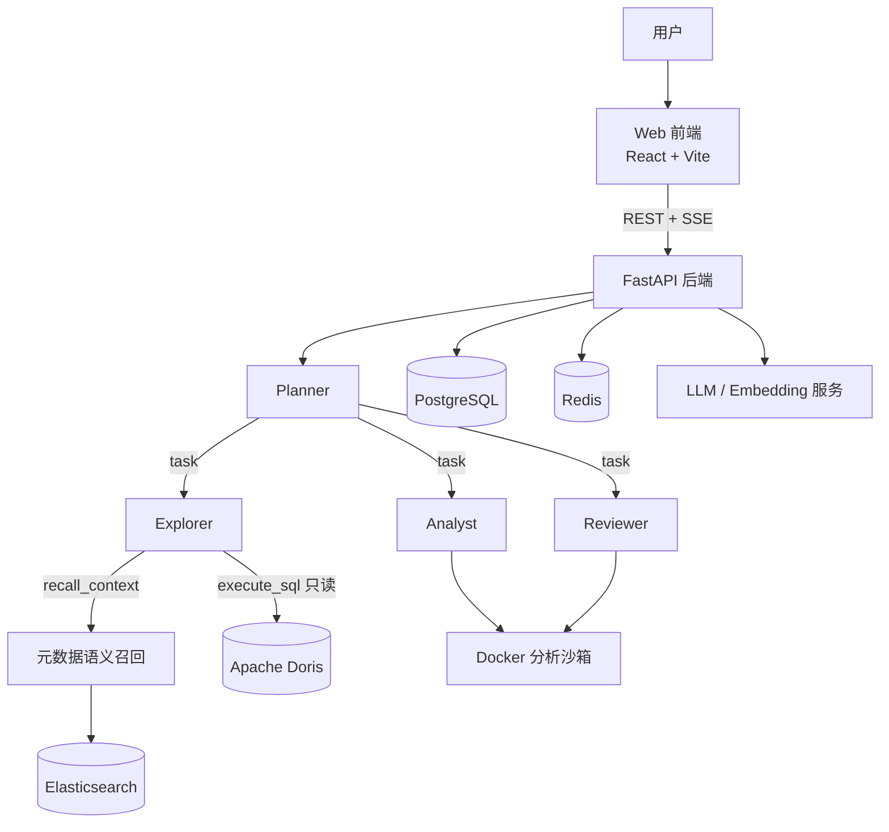

# DataAgent

面向电商数仓的智能数据查询与分析 Agent。用户用自然语言提问，系统自动完成**元数据理解 → SQL 取数 → 统计分析 → 结果审查 → 报告交付**。

后端基于 FastAPI + LangGraph/DeepAgents，数据侧对接 Apache Doris、PostgreSQL、Redis 与 Elasticsearch；前端为 React 单页应用，提供会话、流式输出、文件与图表展示。

---

## 当前进度

项目正在按章节迭代，目前公共底座已完成，业务模块尚未接入：

| 模块 | 状态 | 说明 |
| --- | --- | --- |
| `app/shared` | ✅ 已完成 | 配置、客户端、错误体系、可观测性、契约、数据库基类 |
| `app/identity` | 🚧 待实现 | 预定义用户与 Doris 查询身份映射 |
| `app/metadata` | 🚧 待实现 | 元数据目录导入与 ES 语义召回 |
| `app/query` | 🚧 待实现 | SQL 受控校验与流式执行 |
| `app/assistant` | 🚧 待实现 | 会话、Run 与四 Agent 编排 |
| `app/sandbox` | 🚧 待实现 | Docker 分析沙箱 |
| `main.py` / `app/runtime.py` | 🚧 待实现 | 应用资源装配与 HTTP 入口 |
| `web/` | ✅ 可直接使用 | 前端工程（当前为本地目录，未纳入版本库） |
| `dbmock/` | ✅ 可直接使用 | 45 表电商模拟数仓生成器（当前为本地目录，未纳入版本库） |

> 现阶段运行 `main.py` 会抛出 `NotImplementedError`，后端服务将在后续章节补齐。

---

## 架构概览



- **Planner**：理解目标、拆解任务、委派专业 Agent 并汇总交付，不直接写或执行 SQL。
- **Explorer**：检索元数据、确认口径、执行只读 SQL，交付完整 CSV 与结构说明。
- **Analyst**：统计分析、归因下钻、绘图与自包含 HTML 报告。
- **Reviewer**：独立复核数据、SQL、计算过程与产物一致性。
- 专业 Agent 的提示词位于 `resources/assistant/`，分析技能位于 `resources/assistant/analyst/skills/`。

---

## 技术栈

| 层次 | 选型 |
| --- | --- |
| 运行时 | Python 3.13、uv |
| Web / Agent | FastAPI、LangGraph、DeepAgents、LangChain |
| 数据访问 | SQLAlchemy 2（async）、asyncmy、psycopg 3 |
| 配置与校验 | Pydantic 2、OmegaConf、python-dotenv |
| 存储 | Apache Doris、PostgreSQL、Redis、Elasticsearch |
| 模型 | DeepSeek（OpenAI 兼容接口）、BGE-M3 Embedding（SiliconFlow） |
| 可观测性 | Loguru（控制台 + JSONL） |
| 前端 | React 19、TypeScript、Vite 7、Tailwind CSS、Zustand |
| 工程工具 | Ruff、Pyright、pytest、Biome、Vitest |

---

## 目录结构

```text
.
├── app/
│   ├── shared/                    # 公共底座（已完成）
│   │   ├── config/app_config.py   # app_config.yaml + .env 加载与校验
│   │   ├── clients/               # Doris / PostgreSQL / ES / Embedding 客户端
│   │   ├── errors/                # ProblemError + 全局异常处理器
│   │   ├── observability/         # 日志、链路上下文、请求追踪中间件
│   │   ├── contracts/             # 跨模块共享契约（AgentType 等）
│   │   ├── database/base.py       # SQLAlchemy 声明基类
│   │   └── async_runtime.py       # 事件循环与异步运行辅助
│   ├── identity/                  # 用户身份与 Doris 凭据映射
│   ├── metadata/                  # 元数据目录与 ES 语义召回
│   ├── query/                     # SQL 校验与流式执行
│   ├── assistant/                 # 会话、Run 与 Agent 编排
│   ├── sandbox/                   # Docker 分析沙箱
│   └── runtime.py                 # 应用资源装配
├── conf/
│   ├── app_config.yaml            # 应用配置（端口、连接、模型等）
│   ├── meta_config.yaml           # 元数据目录定义（由 Doris DDL 生成，勿手改）
│   └── .env.example               # 环境变量模板
├── resources/assistant/           # 四角色提示词与技能
│   ├── planner/prompt.md
│   ├── explorer/prompt.md
│   ├── analyst/prompt.md
│   ├── analyst/skills/
│   ├── reviewer/prompt.md
│   └── title.md                   # 会话标题生成提示词
├── dbmock/                        # 模拟数仓生成器（本地目录）
├── web/                           # 前端工程（本地目录）
├── tests/                         # 后端测试
├── main.py                        # 程序入口
├── pyproject.toml
└── uv.lock
```

---

## 快速开始

### 1. 环境要求

- Python **3.13** 与 [uv](https://docs.astral.sh/uv/)
- Node.js **20.19+ / 22.12+**（Vite 7 要求）与 npm
- 可访问的 Doris、PostgreSQL、Redis、Elasticsearch
- 分析沙箱需要 Docker（本机或远程 Docker 宿主）

### 2. 安装后端依赖

```bash
uv sync
```

### 3. 配置环境变量

```bash
cp conf/.env.example conf/.env
```

在 `conf/.env` 中补齐密钥：

| 变量 | 用途 |
| --- | --- |
| `POSTGRES_PASSWORD` | PostgreSQL 密码（身份、元数据、会话库共用） |
| `REDIS_PASSWORD` | Redis 密码（元数据导入锁、沙箱归属锁） |
| `ELASTIC_PASSWORD` | Elasticsearch 内置用户 `elastic` 的密码 |
| `DORIS_ADMIN_PASSWORD` | Doris 管理账号密码 |
| `DORIS_CREDENTIAL_ENCRYPTION_KEY` | Doris 查询凭据的 Fernet 加密密钥 |
| `DEEPSEEK_API_KEY` | 语言模型 API Key |
| `SILICONFLOW_API_KEY` | Embedding 服务 API Key |

生成 Fernet 密钥：

```bash
uv run python -c 'from cryptography.fernet import Fernet; print(Fernet.generate_key().decode())'
```

可选覆盖项：`SANDBOX_REDIS_URL`、`SANDBOX_DOCKER_HOST`（留空连接本机 Docker）。

连接地址、模型名、CORS 等非密钥配置在 `conf/app_config.yaml` 中统一维护；`.env` 只负责注入密钥。配置采用 `extra="forbid"` 校验，出现未知字段会直接启动失败。

### 4. 准备模拟数据（可选）

`dbmock/` 是一个独立的数仓数据生成器，可在 Doris 中创建 `ecommerce` 库的 **45 张业务表**并生成连续月份数据。

```bash
cd dbmock
uv sync

# 按 dbmock/README.md 创建 dbmock/.env，至少包含：
# DB_HOST / DB_PORT / DB_USER / DB_PASSWORD / DB_NAME

uv run scripts/init_db.py                                  # 重建库表
uv run main.py --start-month 2026-01 --end-month 2026-08   # 首次生成
uv run main.py --end-month 2026-09                         # 追加月份
uv run main.py --start-month 2026-01 --end-month 2026-08 --smoke  # 5% 规模验证
```

也可使用 `make init-db`、`make generate start=... end=...`、`make smoke ...`。`data/` 中的数据文件通过 Git LFS 管理，首次使用前需执行 `git lfs install && git lfs pull`。完整说明见 [`dbmock/README.md`](dbmock/README.md)。

### 5. 启动前端

```bash
cd web
npm install
npm run dev
```

前端开发服务器端口与后端联调代理：

- 前端端口：`web/src/config/settings.ts` 中的 `VITE_SERVER_PORT`（默认 `7001`）。
- 代理目标：环境变量 `VITE_APP_PROXY`（默认 `http://localhost:70001`）。
- 后端端口：`conf/app_config.yaml` 的 `port`（默认 `7001`）。

默认前后端端口相同，联调前请调整其中一个端口，并确保代理指向实际后端，例如在 `web/.env.local` 中写入：

```dotenv
VITE_APP_PROXY=http://localhost:7001
```

### 6. 后端服务

后端入口尚未实现（`main.py` 仍为占位）。当前可先执行静态检查与测试：

```bash
uv run ruff check .
uv run ruff format --check .
uv run pyright
uv run pytest
```

---

## 配置说明

`conf/app_config.yaml` 覆盖以下配置组：

- **服务**：监听端口、CORS Origin、日志级别与滚动策略。
- **连接**：Doris 管理连接、三个 PostgreSQL 库（`auth` / `meta` / `langgraph`）、Elasticsearch、Embedding、Redis。
- **安全**：Doris 查询凭据的加密密钥、沙箱 Docker 宿主。
- **模型**：`lm_config.models` 声明可用模型，`lm_config.use` 指定默认模型，`agent.specialists` 为各专业 Agent 选择模型（`default` 表示跟随默认模型）。

`conf/meta_config.yaml` 由 Doris DDL 与语义规则生成，描述表角色、字段说明、别名及是否索引取值，**请勿手工编辑**；元数据导入后用于 Elasticsearch 语义召回。

---

## 核心设计

### 错误处理

所有异常统一输出 RFC 9457 Problem Details（`application/problem+json`）：

```json
{
  "type": "validation-error",
  "title": "参数校验失败",
  "status": 422,
  "detail": "请求参数不符合接口要求",
  "instance": "/api/v1/chat/create",
  "errors": [{ "type": "missing", "location": ["body", "query"], "message": "Field required" }]
}
```

业务代码抛出 `ProblemError` 即可；参数校验、原生 `HTTPException` 与未捕获异常由 `register_exception_handlers()` 兜底。5xx 记录完整堆栈并对外隐藏细节，4xx 仅记 warning。

### 可观测性

- 请求进入时生成/透传 `X-Request-ID`、`X-Trace-ID`，写入 `ContextVar` 并在响应头返回。
- 日志同时输出到控制台与 `logs/YYYY-MM-DD.jsonl`，自动附带请求方法、路径、用户、客户端 IP、链路 ID。
- 请求结束后恢复上下文，避免异步任务复用导致身份信息串请求。

### Agent 协作约束

- 数据库访问只能通过 Explorer 的 `execute_sql`，且仅允许单条 `SELECT` / `WITH`；不执行 DDL、DML、多语句 SQL。
- 取数结果同时返回 `path`、`columns`、`row_count`、`sample`，完整数据以 CSV 文件交付，`sample` 不作为分析依据。
- 收到 `permission_denied` 时立即终止当前任务，不换表、不换账号、不绕过；由 Planner 告知用户联系管理员开通权限。
- 结论须区分观察结果、统计推断与待验证假设；综合分析报告必须交付自包含 HTML。

### 前端接口契约

前端已按以下后端接口开发（`web/src/config/settings.ts`）：

| 能力 | 路径 |
| --- | --- |
| 用户列表 | `GET /api/v1/users` |
| 创建会话 | `POST /api/v1/chat/create` |
| 会话列表 / 删除 | `GET /api/v1/chat/ls`、`POST /api/v1/chat/delete` |
| 会话消息 | `GET /api/v1/chat/ls/{conversationId}` |
| 附件下载 | `GET /api/v1/chat/attachment/get` |
| 流式对话 / 恢复 | `POST /api/v1/chat/stream`、`POST /api/v1/chat/{id}/resume` |
| Run 状态 / 事件 / 停止 | `GET /api/v1/chat/{id}/run`、`GET /api/v1/chat/{id}/events`、`POST /api/v1/chat/{id}/stop` |

后端接口将随 `assistant` 模块实现。

---

## 开发命令

| 范围 | 命令 | 说明 |
| --- | --- | --- |
| 后端 | `uv run ruff check .` | 代码检查 |
| 后端 | `uv run ruff format --check .` | 格式检查 |
| 后端 | `uv run pyright` | 类型检查 |
| 后端 | `uv run pytest` | 运行测试 |
| 前端 | `npm run test` | Vitest |
| 前端 | `npm run lint` / `npm run lint:fix` | Biome 检查 / 修复 |
| 前端 | `npm run format` | Biome 格式化 |
| 前端 | `npm run build` | 类型检查 + 生产构建 |
| dbmock | `make help` | 查看数据生成命令 |

---

## 注意事项

- `conf/.env` 包含真实密钥，已被 `.gitignore` 忽略，请勿提交。
- `web/` 与 `dbmock/` 当前也在 `.gitignore` 中，作为本地子项目维护。
- `conf/meta_config.yaml` 为生成产物，修改应回到上游 DDL 或生成脚本。
- 仓库当前处于开发阶段，接口与目录结构可能随章节推进调整。
